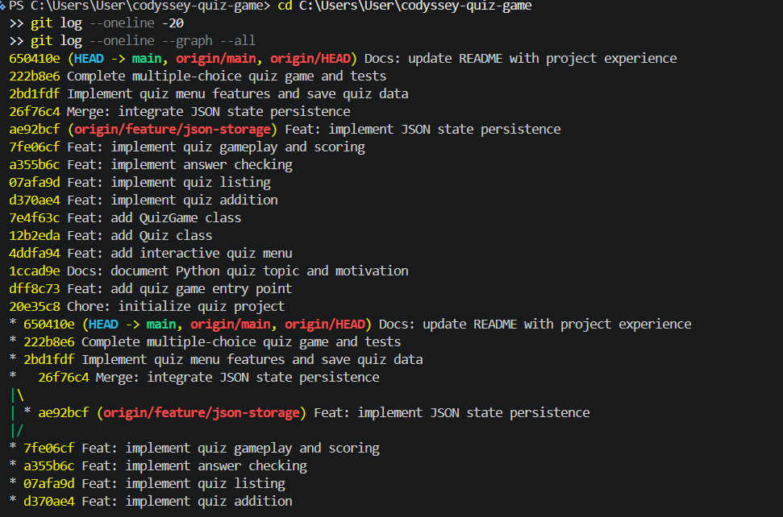
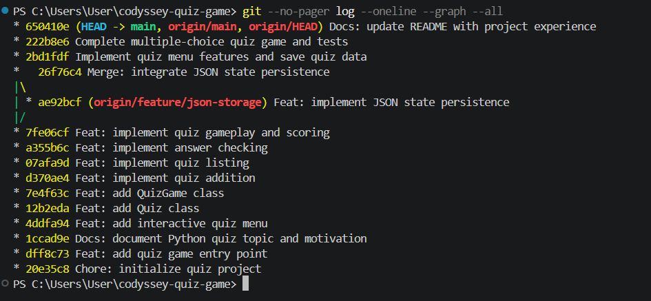
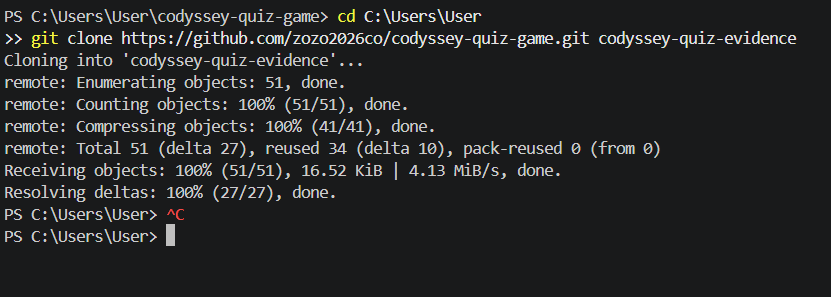
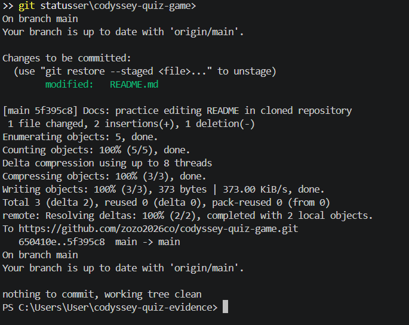
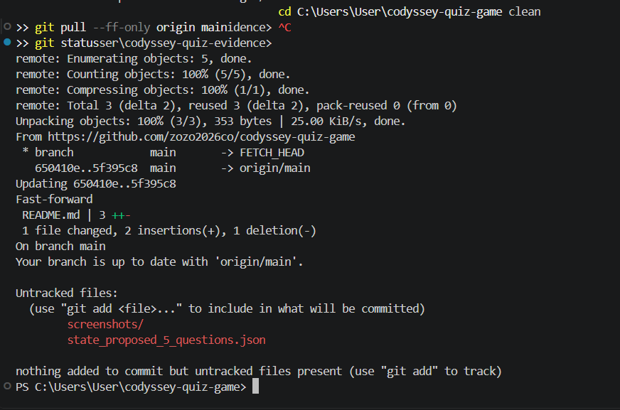

# 파이썬 기초 퀴즈 게임

## 1. 프로젝트 소개

코디세이에서 파이썬을 배우면서 만든 콘솔 퀴즈 게임입니다.

처음에는 메뉴를 출력하는 것부터 시작했습니다. 그다음 퀴즈를 추가하고, 정답을 확인하고, 점수를 저장하는 기능을 하나씩 만들었습니다. 처음부터 한 번에 잘된 건 아니지만, 직접 실행해 보고 오류를 고치면서 완성했습니다.

주제는 **파이썬 기초 문법**입니다. 제가 처음 공부할 때 헷갈렸던 함수와 조건문, 반복문 등을 문제로 만들어 복습하고 싶었습니다.

- **개발 환경:** Windows 11, Python 3.14.10, Visual Studio Code
- **사용한 도구:** Python, Git, GitHub
- **GitHub:** https://github.com/zozo2026co/codyssey-quiz-game

## 2. 퀴즈 문제

기본 문제는 **5개**이며, 각 문제마다 **선택지 4개와 정답 1개**가 있습니다. 기본 문제는 파이썬 기초 문법이라는 주제 안에서 서로 다른 내용을 다루도록 구성했습니다.

| 번호 | 내용 | 정답 |
| --- | --- | --- |
| 1 | 글자를 출력하는 함수 | `print()` |
| 2 | 사용자 입력을 받는 함수 | `input()` |
| 3 | 정수를 나타내는 자료형 | `int` |
| 4 | 조건을 판단하는 키워드 | `if` |
| 5 | 반복문을 만드는 키워드 | `for` |

문제는 `state.json`의 `quizzes` 목록에 순서대로 저장합니다. 현재는 별도의 문제 ID나 난이도 태그를 두지 않았습니다. 앞으로 문제 수가 많아지면 번호 대신 고유 ID나 난이도 구분을 추가하는 방법도 생각해 볼 수 있을 것 같습니다.

## 3. 프로그램 실행 방법

Python이 설치된 터미널에서 아래 명령어를 실행합니다.

```bash
git clone https://github.com/zozo2026co/codyssey-quiz-game.git
cd codyssey-quiz-game
python main.py
```

프로그램을 실행하면 다음 메뉴가 나옵니다.

```text
코디세이 파이썬 기초 퀴즈 게임

============================
1. 퀴즈 풀기
2. 퀴즈 추가
3. 퀴즈 목록 보기
4. 최고 점수 보기
5. 종료
메뉴 번호를 선택하세요 (1~5):
```

메뉴의 기능은 다음과 같습니다.

| 메뉴 | 기능 |
| --- | --- |
| 1. 퀴즈 풀기 | 저장된 문제를 차례대로 풀고 점수를 확인합니다. |
| 2. 퀴즈 추가 | 문제, 선택지 4개, 정답 번호를 입력하여 저장합니다. |
| 3. 퀴즈 목록 보기 | 등록된 문제와 선택지, 정답을 확인합니다. |
| 4. 최고 점수 보기 | 최고 점수를 현재 문제 수와 함께 표시합니다. |
| 5. 종료 | 게임을 종료합니다. |

실제로 기본 문제 5개를 모두 맞혀 **최종 점수 `5/5`**를 확인했고, 메뉴 4번에서도 **최고 점수 `5/5`**가 표시되는 것을 확인했습니다. 메뉴를 선택한 뒤 다시 메뉴 화면으로 돌아오는 동작과 종료 기능도 확인했습니다.

> 최고 점수의 분모는 현재 등록된 문제 수입니다. 나중에 문제를 추가하면 과거 기록 당시의 문제 수와 달라질 수 있다는 한계가 있습니다.

## 4. 파일 구성과 역할

처음에는 모든 코드를 한 파일에 넣는 것이 편해 보였습니다. 그런데 기능이 늘어나니 어떤 부분을 수정해야 할지 찾기 어려웠습니다. 그래서 역할을 나눠 보았습니다.

| 파일 | 하는 일 |
| --- | --- |
| `main.py` | 메뉴 출력, 사용자 입력, 메뉴 선택에 따른 기능 실행 |
| `quiz.py` | 한 문제의 내용·보기·정답을 보관하고 정답인지 확인 |
| `quiz_game.py` | 여러 문제 관리, 출제, 점수 계산, JSON 읽기와 저장 |
| `state.json` | 기본 문제와 최고 점수 데이터 |
| `test_quiz_game.py` | 기능이 예상대로 작동하는지 자동으로 확인 |
| `README.md` | 프로젝트 소개와 사용법, 실습 기록 |
| `screenshots/` | Git 실습 과정의 실제 화면 |

### 왜 클래스를 사용했을까?

`Quiz` 클래스는 **퀴즈 한 문제**를 담당합니다. 문제와 정답을 기억하고 `check_answer()`로 답이 맞는지 검사합니다.

`QuizGame` 클래스는 **퀴즈 게임 전체**를 담당합니다. `add_quiz()`로 문제를 추가하고, `list_quizzes()`로 목록을 보여주며, `play_quiz()`로 퀴즈를 진행합니다. `load_state()`와 `save_state()`는 저장된 데이터를 읽거나 기록합니다.

함수만 사용해도 작은 프로그램을 만들 수 있지만, 클래스에 관련 정보와 기능을 묶으니 여러 문제와 최고 점수를 관리하기 편했습니다. 대신 처음에는 클래스와 인스턴스의 차이를 이해하는 데 시간이 걸렸습니다. 작은 게임에서는 함수만 쓰는 편이 더 단순할 수도 있다고 생각합니다.

### 입력 처리와 파일 저장을 나눈 기준

- **`main.py`**에서는 메뉴 번호를 입력받고 1~5 중 하나인지 확인합니다. 새 문제를 추가할 때는 문제와 보기, 정답 번호를 입력받습니다.
- **`quiz.py`**에서는 문제와 정답 형식이 올바른지 확인하고, 사용자가 고른 답을 비교합니다.
- **`quiz_game.py`**에서는 문제를 출제하고 점수를 관리합니다. 파일을 실제로 읽거나 저장하는 작업은 `load_state()`와 `save_state()`에서 처리합니다.

사용자에게 입력을 요청하는 부분과 파일을 다루는 부분이 서로 섞이지 않도록 나누려고 했습니다. 다만 퀴즈 진행 중 답을 입력받는 부분은 현재 `play_quiz()` 안에 있습니다. 나중에는 입력 전용 함수로 더 깔끔하게 분리할 수 있을 것 같습니다.

## 5. JSON 데이터 저장 방법

프로그램을 종료한 뒤에도 퀴즈와 최고 점수가 남도록 `state.json`을 사용했습니다. JSON은 메모장으로도 내용을 확인할 수 있어서 처음 배우는 입장에서 이해하기 편했습니다.

데이터 구조는 아래와 같습니다. 예시는 실제 5문제 중 첫 문제만 간단히 보여준 것입니다.

```json
{
  "best_score": 5,
  "quizzes": [
    {
      "question": "Python에서 글자를 출력하는 함수는?",
      "choices": ["input()", "print()", "len()", "int()"],
      "answer": "2"
    }
  ]
}
```

- `best_score`: 지금까지 기록한 최고 점수
- `quizzes`: 여러 문제를 담은 목록
- `question`: 문제 내용
- `choices`: 선택지 4개
- `answer`: 정답 보기 번호를 **문자열**로 저장한 값

최고 점수와 문제 목록을 하나의 파일 안에 담아 두니 게임을 시작할 때 함께 불러올 수 있었습니다. 각 문제를 하나의 묶음으로 저장하면 문제와 보기가 섞이지 않는 장점도 있습니다.

### 파일을 저장하는 순서

`load_state()`는 파일을 읽고 데이터 구조를 확인한 뒤 사용할 수 있는 문제를 불러옵니다. 형식이 잘못된 문제는 출제에서 제외하지만 원래 데이터를 최대한 보존하도록 만들었습니다.

`save_state()`는 바로 `state.json`을 덮어쓰기보다 **임시 파일에 먼저 기록하고, 기록이 끝나면 교체**하는 방식을 사용합니다. 저장 도중 문제가 생겼을 때 원본 파일이 망가질 가능성을 줄이기 위해서입니다.

기존 파일이 심하게 손상되거나 JSON 구조가 잘못된 경우에는 무리하게 저장하지 않도록 했습니다. 하지만 **자동 백업 파일 생성과 자동 복구 기능까지 구현한 것은 아닙니다.**

### JSON 방식의 한계

지금처럼 문제 수가 적은 게임에는 JSON이 편합니다. 하지만 문제가 매우 많아지면 전체 파일을 읽고 다시 저장해야 해서 느려질 수 있습니다. 여러 사람이 동시에 같은 파일을 수정할 때도 충돌이 생길 수 있습니다. 그런 프로그램을 만든다면 SQLite 같은 데이터베이스를 알아보고 싶습니다.

## 6. 입력 오류와 데이터 오류에 대한 처리

사용하다 보면 실수로 다른 번호를 누를 수도 있어서 다음 상황을 고려했습니다.

| 상황 | 현재 동작 |
| --- | --- |
| 메뉴에 1~5 이외 입력 | 안내 메시지를 보여주고 다시 입력받음 |
| 4지선다에 1~4 이외 입력 | 올바른 번호가 나올 때까지 다시 입력받음 |
| 새 문제에서 빈 문제·보기 입력 | 해당 문제 추가를 취소하거나 입력을 안내함 |
| `Ctrl+C`, 입력 종료(EOF) | 프로그램을 안전하게 종료하도록 처리 |
| `state.json` 없음 | 빈 게임으로 시작할 수 있도록 안내 |
| JSON 내용 손상 또는 구조 오류 | 기존 파일 보호를 위해 저장을 막음 |
| 일부 문제만 잘못된 형식 | 해당 문제는 출제하지 않고 기존 데이터는 보존 |

안내 문구는 한국어로 작성했고, 입력할 수 있는 번호 범위를 가능한 한 함께 표시했습니다. 다른 언어로 바꾸는 기능은 아직 없습니다.

### 저장 파일에 문제가 생겼을 때 직접 복구하는 방법

1. 프로그램을 종료합니다.
2. **기존 `state.json`을 다른 이름으로 복사해 먼저 보관합니다.** 손상된 파일도 바로 삭제하지 않습니다.
3. `state.json`을 VS Code에서 열어 괄호, 쉼표, 따옴표, `best_score`, `quizzes` 등의 형식을 확인합니다.
4. 파일을 직접 고치기 어렵다면 이전에 보관해 둔 정상 백업본을 이용해 복원합니다.
5. `python main.py`로 다시 실행해 문제 목록과 최고 점수를 확인합니다.

읽기 오류가 계속 난다면 파일이 실제로 있는지, 저장 폴더에 접근 권한이 있는지 확인합니다. 복구할 백업본이 없는 경우에는 원래 데이터를 되살리지 못할 수 있으므로, 중요한 파일은 미리 복사해 두는 것이 좋다고 배웠습니다.

## 7. 테스트 결과

직접 게임을 실행해 5문제를 풀어 보았고, 자동 테스트도 실행했습니다.

```bash
python -m unittest discover -v
```

실행 결과:

```text
Ran 12 tests in 0.023s

OK
```

12개 테스트에서 정답 판정, 잘못된 입력, 데이터 저장과 다시 읽기, 최고 점수 갱신, 잘못된 JSON 파일 처리, 안전한 종료 등을 확인했습니다.

테스트에 통과했더라도 실제 사용 중에는 다른 문제가 생길 수 있으므로, 직접 메뉴를 눌러 보는 과정도 필요하다고 느꼈습니다.

## 8. Git과 GitHub 작업 기록

이번 프로젝트에서는 기능을 조금씩 만들고 그때마다 Git으로 기록을 남겼습니다. 처음에는 명령어가 헷갈렸지만, 실제로 여러 번 사용하면서 익숙해졌습니다.

### 커밋을 나눈 기준

메뉴 작성, 클래스 추가, 정답 확인, 퀴즈 출제, JSON 저장처럼 **한 가지 기능을 작업한 뒤 확인하고 커밋**하려고 했습니다. 메시지는 대체로 `Feat: 기능 설명`, `Docs: 문서 설명`, `Chore: 기타 작업`처럼 변경 내용을 알아볼 수 있게 작성했습니다.

예를 들어 `Feat: add Quiz class`, `Feat: implement answer checking`, `Docs: update README with project experience`와 같은 기록이 있습니다. 일부 커밋은 설명형 문장으로 작성했는데, 앞으로는 메시지 형식을 더 일관되게 쓰고 싶습니다.

### ① 커밋 기록 — 10개 이상

Git 로그에서 초기 프로젝트 생성부터 메뉴, 퀴즈 기능, JSON 저장, README 수정까지 **10개가 넘는 커밋**을 확인했습니다.



### ② 브랜치 생성 및 병합

JSON 저장 기능을 작업할 때 `feature/json-storage` 브랜치를 사용했습니다. 기능을 따로 작업한 다음 `main`에 합쳤습니다.

브랜치를 따로 사용하면 새로운 기능을 만들면서 기존 `main`의 작업과 구분할 수 있고, 병합 기록을 통해 어떤 기능을 추가했는지 확인하기 편하다는 것을 배웠습니다.

병합 커밋은 `26f76c4`이며, 그래프에서 갈라진 작업이 다시 합쳐지는 모습을 확인할 수 있습니다.



### ③ 다른 폴더로 저장소 복제하기

별도의 `codyssey-quiz-evidence` 폴더에 GitHub 저장소를 `git clone`으로 복제했습니다. 원래 작업하던 폴더를 바로 수정하지 않고 복제본에서 실습하기 위해서였습니다.



### ④ 복제본에서 README 수정·커밋·push

복제한 폴더의 README에 실습 내용을 짧게 추가하고 커밋한 다음, GitHub의 `main` 브랜치에 올렸습니다.

이때 생성한 커밋은 **`5f395c8`**입니다.



### ⑤ 원본 폴더에서 pull

다시 원래 프로젝트 폴더로 돌아와 `git pull --ff-only origin main`을 실행했습니다. `Fast-forward` 결과를 통해 복제본에서 올린 README 변경 사항이 원래 폴더에도 반영된 것을 확인했습니다.



이 실습을 통해 `clone`은 저장소를 복제하는 것, `commit`은 로컬 작업 기록을 남기는 것, `push`는 그 기록을 GitHub에 올리는 것, `pull`은 GitHub의 변경 내용을 가져오는 것이라는 차이를 이해하게 됐습니다.

## 9. 나중에 기능을 수정한다면

처음에는 어느 파일을 고쳐야 하는지 몰라서 여러 번 헤맸습니다. 다음에 다시 수정할 때 참고하려고 정리했습니다.

| 바꾸고 싶은 내용 | 먼저 살펴볼 파일·함수 |
| --- | --- |
| 메뉴 이름이나 메뉴 번호 | `main.py`의 `main()`, `read_menu()` |
| 새 문제 입력 방식 | `main.py`의 `add_new_quiz()` |
| 문제·보기 형식 또는 정답 판정 | `quiz.py`의 `Quiz`, `check_answer()` |
| 문제 추가와 목록 출력 | `quiz_game.py`의 `add_quiz()`, `list_quizzes()` |
| 출제 방식과 점수 계산 | `quiz_game.py`의 `play_quiz()` |
| JSON에서 읽어 오는 방식 | `quiz_game.py`의 `load_state()` |
| JSON 저장 방식 | `quiz_game.py`의 `save_state()` |
| 기본 퀴즈 문제 | `state.json`의 `quizzes` |
| 자동 테스트 추가 | `test_quiz_game.py` |

데이터 구조를 바꾸게 된다면 `Quiz`의 입력 형식, `load_state()`와 `save_state()`의 데이터 처리, 테스트 코드를 함께 확인해야 합니다.

## 10. 어려웠던 점과 느낀 점

제일 기억에 남는 것은 **처음에는 퀴즈가 주관식으로 나왔다는 점**입니다. 과제에는 선택지 4개가 필요했는데, 제가 만든 데이터에는 문제와 정답만 있었습니다. 요구사항을 다시 확인하고 4지선다 5문항으로 바꿨습니다.

또 점수 자체는 잘 계산됐지만 최고 점수가 `5`로만 표시돼서 `5/5`로 바꾸기도 했습니다. 아주 작은 부분 같아도 직접 실행해 보니 사용자가 보기 편한 출력도 중요하다는 생각이 들었습니다.

다른 컴퓨터에서 작업하면서 Python을 새로 설치해야 했고, Git 작성자 정보가 없어 커밋이 실패하기도 했습니다. GitHub가 이메일 공개를 막아서 `push`가 거부된 적도 있었는데, 이전 커밋에 사용한 가상 이메일로 작성자 정보를 수정해 해결했습니다.

이 과제를 하면서 코드를 쓰는 것만큼 **실행해 보고, 문제가 생기면 원인을 찾고, 다시 확인하는 과정**이 중요하다는 걸 배웠습니다. 아직 익숙하지 않은 부분이 많지만, 처음보다 파이썬과 Git이 어떻게 연결되는지 조금은 알게 된 것 같습니다.
